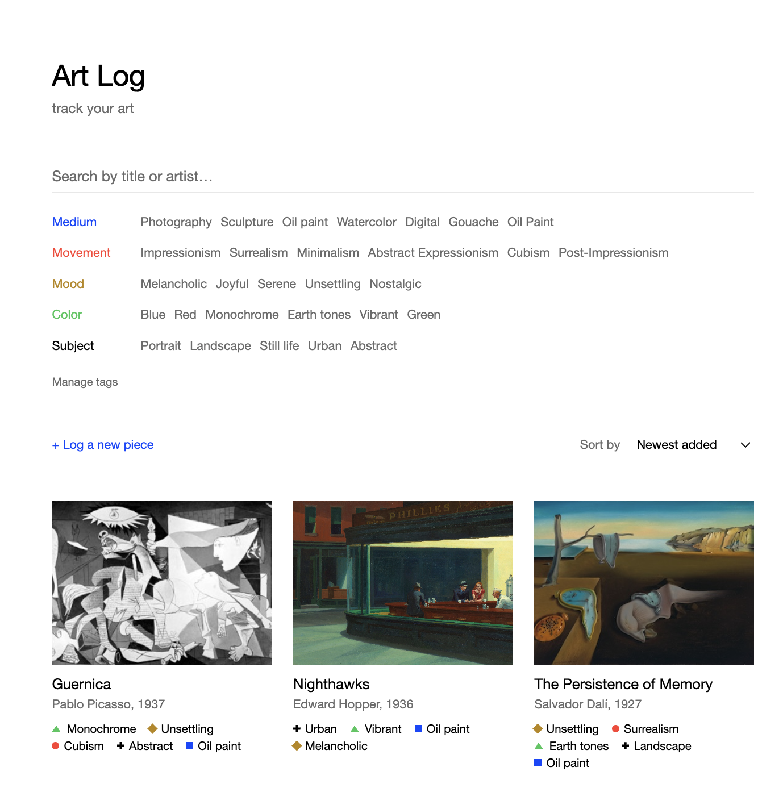

# Art Log

A personal art cataloging tool: save pieces you've encountered, tag them
along independent axes (medium, movement, mood, color, subject), and filter
your collection by any combination of tags.

**Stack:** Spring Boot + GraphQL (backend), PostgreSQL (database), React +
TypeScript + Apollo Client (frontend).



## Architecture

```
React + Apollo Client  ──GraphQL (HTTP POST /graphql)──>  Spring for GraphQL
     (frontend)         ──REST (POST /api/images)─────>     (backend)
                                                                  │
                                                             Spring Data JPA
                                                                  │
                                                             PostgreSQL
```

- The frontend is a single-page app with no router: one page, a modal for
  artwork detail/edit, a modal for tag management. All server state goes
  through Apollo Client's cache; local UI state (the current filter, sort,
  which modal is open) is plain `useState` in `App.tsx`, passed down as
  props — there's no global state library because nothing here needs one.
- The backend exposes one GraphQL endpoint for all reads/writes, plus one
  plain REST endpoint (`POST /api/images`) for file uploads, since GraphQL
  isn't a natural fit for multipart file transport.
- Tags live in a single normalized table with a `type` column (`TagType`
  enum: MEDIUM, MOVEMENT, MOOD, COLOR, SUBJECT) rather than as separate
  fixed columns on `Artwork`. Adding a new axis later is a one-line enum
  change, not a schema migration touching every table and query.

## Backend

**Package layout** (`backend/src/main/java/com/artlog/artlog/`):

- `model/` — `Artwork`, `Tag`, `TagType`. Plain JPA entities; `Artwork.tags`
  is a `@ManyToMany` via an `artwork_tag` join table. `Artwork.setTags`
  defensively copies into a `HashSet` — Hibernate wraps whatever collection
  instance you hand it without copying, so an immutable `Set` passed in
  would blow up the first time anything tried to mutate it later.
- `repository/` — Spring Data repositories, plus `ArtworkSpecifications`:
  the composable tag-filtering logic. Each axis (`hasAnyTag(type, names)`)
  is a correlated `EXISTS` subquery, not a join on the main query — that
  keeps axes independent (AND across axes, OR within an axis) without
  colliding with each other or duplicating rows under pagination.
- `graphql/` — one `@Controller` per concern (`ArtworkQueryController`,
  `ArtworkMutationController`, `TagMutationController`), GraphQL input/
  payload records (`AddArtworkInput`, `UpdateArtworkInput`, `ArtworkPage`,
  etc.), and `GraphQlExceptionHandler`, which maps `IllegalArgumentException`
  (e.g. "a tag with that name already exists") to a GraphQL `BAD_REQUEST`
  error instead of a generic 500.
- `service/TagService` — find-or-create-on-the-fly tagging, tag rename
  (rejects a collision with another tag of the same name+axis), and tag
  delete (detaches the tag from every artwork that has it, rather than
  failing on the `artwork_tag` foreign key).
- `web/ImageUploadController` — a plain REST endpoint that writes uploaded
  images to local disk (`artlog.upload-dir`, default `./uploads`) and
  returns a URL. **This won't survive deployment as-is** — see Next steps.
- `config/WebConfig` — CORS, scoped to `http://localhost:*` so the frontend
  dev server can run on any port Vite picks.

**Filtering and pagination**: `ArtworkQueryController.artworks` takes a
filter, a sort, and page/pageSize, and composes a `Specification<Artwork>`
per request rather than hand-writing a query per filter combination. Tags
are deliberately **not** fetch-joined on the paged query (that would force
Hibernate to paginate in memory over the whole to-many join); instead,
`attachTags` batch-loads tags for just the current page's ids via a second
query and reattaches them in the original sorted order.

**GraphQL schema**: `backend/src/main/resources/graphql/schema.graphqls`.

**Tests** (`backend/src/test`): `ArtworkSpecificationsTest` covers the
AND/OR filter composition and search; `TagServiceTest` covers the rename-
collision and delete-reassociation logic. Both run against a real local
Postgres database (`artlog_test`), not H2 — Postgres-specific behavior
(the `oid`-vs-`text` column mapping, a Hibernate 6 join-fetch collision)
has already bitten this project twice, so fidelity mattered more than
speed. Run with `mvn test`.

## Frontend

**Structure** (`frontend/src/`):

- `App.tsx` — top-level filter/sort state, single-column page layout.
- `components/FilterPanel` — tag checkboxes-turned-plain-text toggles,
  grouped by axis, plus a search box. Fetches available tags live via the
  `tags` query.
- `components/ArtworkGrid` / `ArtworkCard` — fetches the current page of
  artworks and renders cards; "Load more" appends subsequent pages.
- `components/ArtworkDetail` — a modal with the full artwork view, inline
  notes editing, and an "Edit details" mode that reuses `ArtworkForm`.
- `components/ArtworkForm` — the shared add/edit form (title, artist,
  year, image, tags-as-comma-separated-text-per-axis). Used by both
  `AddArtworkForm` and `ArtworkDetail`'s edit mode.
- `components/TagManager` — a modal for renaming/deleting tags, with a
  usage-count warning before deleting a tag that's still in use.
- `components/TagLabel` — a tag rendered as its axis's flat shape (square/
  circle/diamond/triangle/cross) plus its name; this is the one recurring
  visual motif, reused in cards, the detail view, and nowhere else trying
  to be clever.
- `apollo/client.ts`, `graphql/queries.ts`, `graphql/mutations.ts` —
  Apollo Client setup and all GraphQL documents in one place per concern.
- `uploadImage.ts` — posts a file to `/api/images`, returns the URL to
  store on the artwork.

**Design**: plain black-on-white Helvetica, no borders or shadows, a
single accent color (`--accent`, neon blue) used only for primary actions.
Tokens live in `index.css`. There's deliberately no component-library/CSS-
framework dependency — this is a small enough surface that plain CSS per
component is easier to reason about than abstracting early.

**Tests**: `ArtworkForm.test.tsx`, via Vitest + React Testing Library,
covers the comma-separated tag-parsing behavior (trimming, dropping
empties, routing values to the right axis) through the rendered form
rather than exporting the private parsing function. Run with `npm test`.
Note: `vitest.config.ts` is kept separate from `vite.config.ts` — vitest
ships its own nested `vite` dependency, and mixing it with the top-level
`vite` + `@vitejs/plugin-react` in one config produces incompatible
plugin types.

## Local setup

**Requirements:** Java 21, Maven, Node, PostgreSQL 16.

### Database

```bash
docker compose up -d   # if Docker is available
```

Otherwise, install Postgres directly and create a matching role/database:

```bash
brew install postgresql@16
brew services start postgresql@16
createdb artlog
psql -d artlog -c "CREATE ROLE artlog WITH LOGIN PASSWORD 'artlog';"
psql -d artlog -c "ALTER DATABASE artlog OWNER TO artlog;"
psql -d artlog -c "GRANT ALL ON SCHEMA public TO artlog;"
```

The app expects a database `artlog` at `localhost:5432`, role/password
`artlog`/`artlog` (override via `DB_USERNAME`/`DB_PASSWORD`). Tests expect
a second database, `artlog_test`, owned by the same role.

### Run

```bash
cd backend && mvn spring-boot:run   # http://localhost:8080/graphiql
cd frontend && npm install && npm run dev   # http://localhost:5173 (or whatever port Vite picks)
```

On backend startup, Hibernate creates the schema (`ddl-auto: update`) and
`data.sql` seeds a starter set of tags.

### Test

```bash
cd backend && mvn test
cd frontend && npm test
```

## Next steps

1. **Image storage** — `ImageUploadController` writes to local disk, which
   won't survive a deploy (most hosts have ephemeral or no persistent
   filesystem). Move to S3 or Cloudinary before deploying.
2. **Deploy** — nothing is deployed yet. Backend → Render/Railway with a
   managed Postgres instance; frontend → Vercel/Netlify.
3. **Test coverage** — add tests alongside new mutations/components as
   they're touched, rather than another backfill pass; the current tests
   intentionally cover only the logic that's complex enough for a bug to
   be invisible by eye.
4. **Stretch features** (all optional, from the original plan): URL-synced
   filter state for shareable/bookmarkable views; custom "shelves" or
   collections; auth (likely moot for a single-user personal tool, but
   worth a conscious decision).
5. **Real data** — the catalog is functionally complete; the last step is
   actually logging art you've seen.
